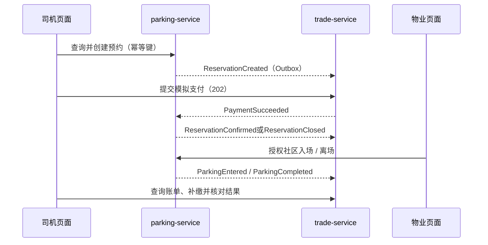

# 悦享泊第3—4周 M1 需求与接口初始基线

日期：2026-10-23。依据：[项目计划](../项目计划.md)第8.2、8.3节。产品全称：悦享泊——智慧社区车位共享与结算平台。

## 1. 阶段范围与完成门槛

本阶段为需求24小时、架构12小时、基础8小时、预约8小时、交易8小时，实施60小时，另留4小时缓冲；这些是计划估算，不是本轮实际耗时。

M1交付：核心业务及AI需求形成初始基线；已有接口可核对；使用演示账号、种子车位及模拟通道，跑通查询、预约、支付、物业入离场和账单。第5—6周补齐资源和管理页面，第7—10周完成预约与资金全规则，第11—12周完成真实AI。不得把种子资源当作发布审核功能，或把模型桩当作AI验收通过。

验收须同时具备：后端构建与单元测试、两种前端构建、独立界面回归、真实服务API及浏览器流程通过；需求/接口/状态和页面追踪可定位。当前结果见[实施与验收记录](../第3—4周实施与验收记录.md)，历史证据不替代当次运行。

## 2. 功能需求与实现追踪

完整规则仍以[需求规格](../需求规格说明书.md)为准。下表“已有”描述代码范围，运行通过与否查验收记录。

| 编号 | M1已有实现或基线 | 尚待交付 | 主要代码与验证入口 |
|---|---|---|---|
| FR01 | 演示账号、BCrypt、登录/退出、会话撤销、限流 | 注册、账号管理界面 | IdentityApi、LoginLimit；business-smoke登录与退出 |
| FR02 | 后端角色、本人记录、物业社区范围校验 | 多角色授予及后台细粒度管理 | Actor、BusinessWeb；API越权场景 |
| FR03 | 演示社区只读列表 | 新增编辑、启停、物业授权 | BusinessParking；GET /communities |
| FR04 | 预置启用车位 | 业主发布、审核、驳回、封禁 | BusinessParking；第5—6周 |
| FR05 | 预置共享窗口，预约时覆盖检查 | 窗口维护、重叠检查及已有预约保护 | BusinessParking；第5—6周 |
| FR06 | 社区和时段查询、整数分报价 | 类型/价格筛选、分页 | BusinessParking、BusinessApp；查询API与界面回归 |
| FR07 | 本人车辆、行锁防冲突、同键重放/异参拒绝 | 100并发专项验收 | BusinessParking、Requests；竞争API场景 |
| FR08 | 取消、10分钟过期释放、迟到收款补偿 | 全量竞态专项验收 | BusinessParking、BusinessListener；API及恢复脚本 |
| FR09 | 物业入离场、车位物理互斥、受阻记录与归因 | 物业主动无法履约处理、完整异常管理 | BusinessParking；API与浏览器闭环 |
| FR10 | 车牌/价格快照、预付与半小时向上取整补缴 | 完整计费规则版本与份额 | Data、BusinessTrade；MoneyTest |
| FR11 | 持久支付尝试、模拟渠道、重复保护、UNKNOWN/REVIEW恢复 | 完整通道故障与正式财务验收 | PaymentWorker、TradeAccounting、TradeReliabilityTest |
| FR12 | 已付款取消或关闭的自动全额模拟退款 | 争议、部分退款、审批与三层额度预留 | TradeAccounting；取消和迟到付款API场景 |
| FR13 | 账单明确NOT_IMPLEMENTED | 份额、结算批次、打款与负向调整 | 第9—10周，不能宣称已结算 |
| FR14 | 暂无业务对账入口 | 差异、复查及结算阻断 | 第9—10周 |
| FR15 | 暂无通知与统计入口 | 站内通知及三类统计 | 第9—10周 |
| FR16 | 演示时钟、支付人工恢复等局部审计 | 业务审核审计及查询界面 | BusinessParking、恢复脚本；第5—10周扩充 |
| FR17 | 本人种子车辆列表、下单归属校验、车牌快照 | 绑定、规范化、停用及有效预约保护 | BusinessParking；车辆API与预约场景 |

当前身份数据为单角色演示模型，不能据现有roles数组宣称多角色管理完成。列表最多100条，没有分页；当前创建预约HTTP 200、异步支付202，以M1契约为准。

## 3. AI需求与只读工具初始契约

AI01—AI05需求已确定，真实能力均未验收。当前AiPrototype位于parking-service，仅验证接口和隔离；目标编排与知识管理位置见总体设计，后续迁移不能直接改变既有业务授权。

| 需求 | 输入与输出约定 | 依赖和验收 |
|---|---|---|
| AI01 自然语言查位 | 缺社区/明确起止时间则追问；预算可选；返回业务数据卡片 | 查询接口；AT01、AT02、AT08 |
| AI02 规则问答 | 检索有效条款，引用ruleId、条款和版本；无依据明确说明 | 规则维护及版本库；AT03 |
| AI03 本人账单解释 | reservationId从本人订单入口取得，事实与金额来自账单；核对billVersion | 账单及授权；AT04、AT08 |
| AI04 条件补全 | 单次找车位任务最多5轮，同会话单在途请求，版本防旧响应覆盖 | 会话与版本控制；AT01、AT07 |
| AI05 降级与审计 | 总截止20秒、日志脱敏、保留普通入口；模型无写权限 | AT05、AT06；当前仅桩隔离得到验证 |

以下是待实现工具契约，**不是已上线HTTP路由**。模型只提出参数；后端验证参数与会话身份后执行，不接受模型提供的userId、角色或权限。

| 工具 | 参数 | 服务端校验 | 结果 |
|---|---|---|---|
| searchAvailableSpaces | communityId:string、startAt/endAt:带偏移时间；maxHourlyFen:可选非负整数、spaceType:可选业务枚举 | 时间对齐、未来范围、合法社区；预算缺省不限；保留用户确认下单 | 候选ID、位置摘要、小时价、预估金额、明确起止时间和查询时间 |
| retrieveParkingRules | query:string、topic:string；communityId/ruleVersion可选 | 历史订单规则版本由服务端注入；仅已发布适用条目 | 最多5条ruleId、条款、版本、生效时间和适用范围；无匹配返回空 |
| getMyOrderBill | reservationId:string | 验证当前用户归属；拒绝他人订单；按同一快照返回 | 预约、停车、收款、退款、净额、billVersion；未就绪保留错误 |

工具白名单仅以上三项。预约、取消、支付、退款、结算均不能作为模型写工具。真实供应商、模型、总预算和每日限额仍待用户决定；不产生外部模型费用。100条模型能力样例及真实HTTP隔离测试留至正式接入阶段。

## 4. 架构、数据和消息基线

浏览器→网关9090→identity9081 / parking9082 / trade9083，注册中心9761。业务库独立，服务间不跨库写入；身份核验失败拒绝受保护请求。内部接口不由网关公开转发。JWT按真实时间，演示业务时钟独立并持久化偏移。

- identity：app_user、login_session及局部审计/Outbox；business迁移V001—V002。
- parking：community、vehicle、parking_space、share_window、reservation_order；business迁移V001—V003。
- trade：trade_order、payment_attempt、channel_operation、ledger_entry；business迁移V001—V002。
- 已执行迁移不可改写，新字段新增迁移。最终设计中的payment_order、refund_order、settlement等不应误认为已落库。
- 业务事实与Outbox本地同事务；事件至少一次传递，消费去重。预约版本与billVersion独立。

预约状态：WAIT_PAY→CONFIRMED→IN_USE→COMPLETED。WAIT_PAY可因到期EXPIRED，开始前主动取消CANCELLED；已确认未入场可按事实转NO_SHOW或SPACE_UNAVAILABLE。迟到收款不能复活关闭订单。支付CREATED/SUBMITTED/UNKNOWN/REVIEW期间禁止新同类扣款；预约确认和收款成功分开显示。M1不包含正式结算状态流转。

## 5. 页面和接口基线

可运行页面为同一BusinessApp内视图，尚无完整独立URL路由：P00登录；P01查询并合并P02预约提交；P03订单、支付和账单；P11物业入离场；P18模型桩入口。P16仅在预约表单选取已有车辆；P04—P10等资源管理和P12—P17后台、结算、通知尚未完整交付。

页面需保留加载、空列表、请求失败及处理中反馈。已覆盖旧账单隔离、条件变化使报价失效、AI请求不锁普通导航。详细原型目标见[前端设计](../前端详细设计说明书.md)，当前接口见[OpenAPI](contracts/openapi-m1.json)及[业务契约](contracts/业务契约-M1.md)。本轮补全全部当前公共业务处理器的接口，含支付、取消、物业操作及模型桩，内部运维接口仍不列为公开能力。

## 6. 复现与后续交接

按[业务演示启动与验收](业务演示启动与验收.md)操作；真实API和浏览器测试会创建演示订单并推进业务时钟，必须串行运行。使用已有随机演示凭据，不把.env、JWT或原始日志提交到证据目录。

M1之后优先实现注册/角色授权、车辆维护、业主车位发布、物业审核、共享窗口管理，再补管理页面及细化追踪。本轮不提前宣称M2—M4完成。变更金额、权限或状态规则时，同时更新需求、接口、迁移与验收用例。
