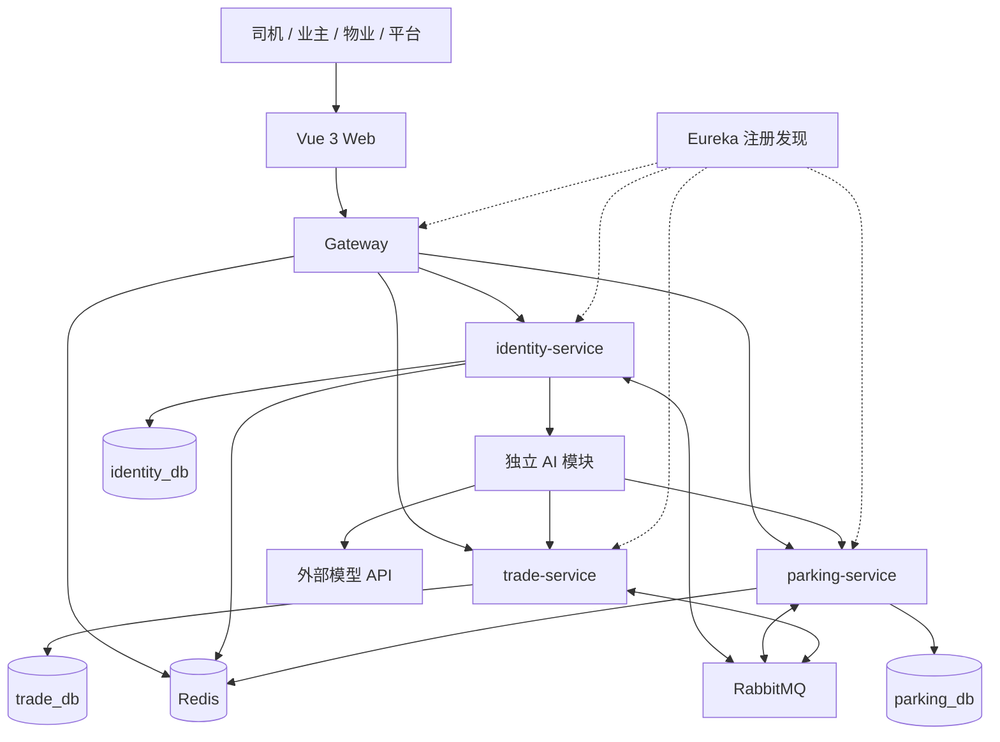
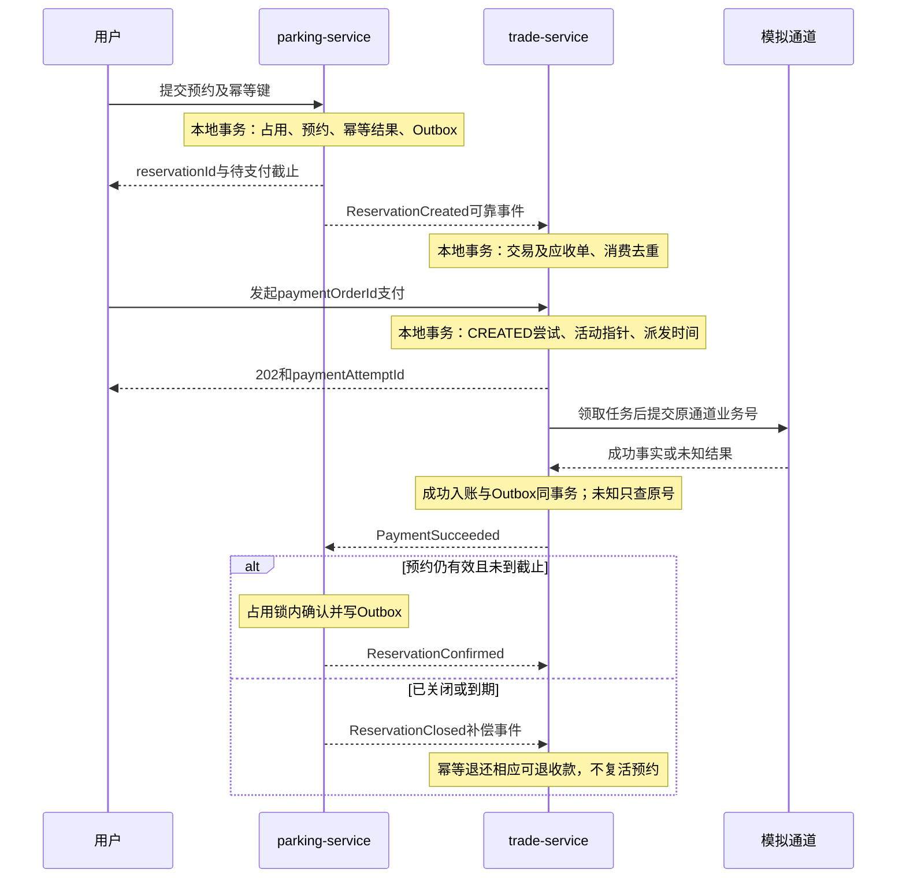
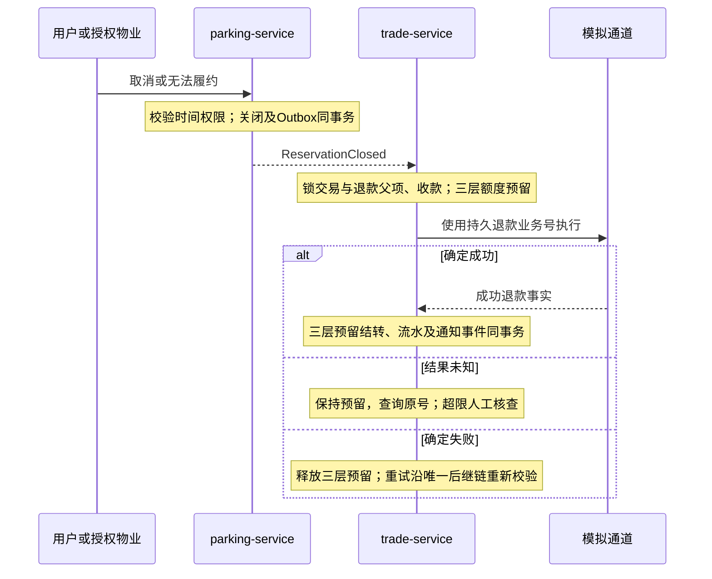
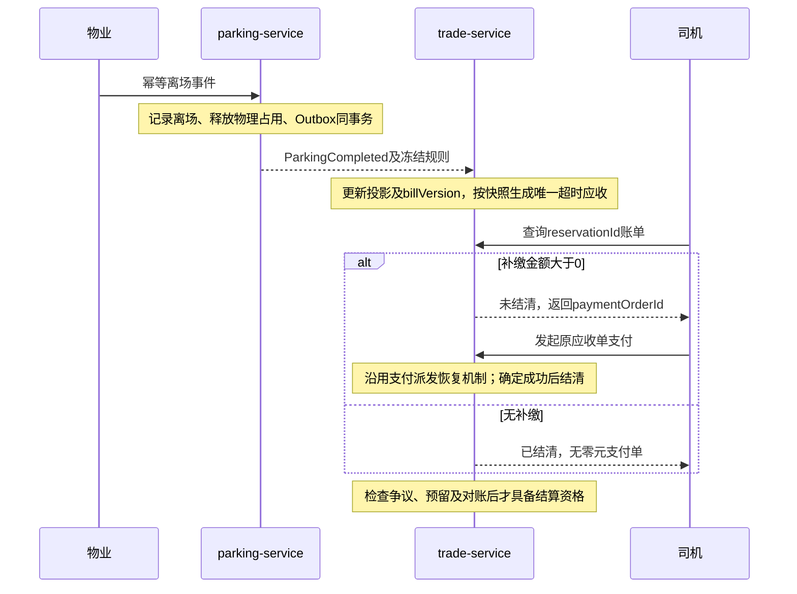
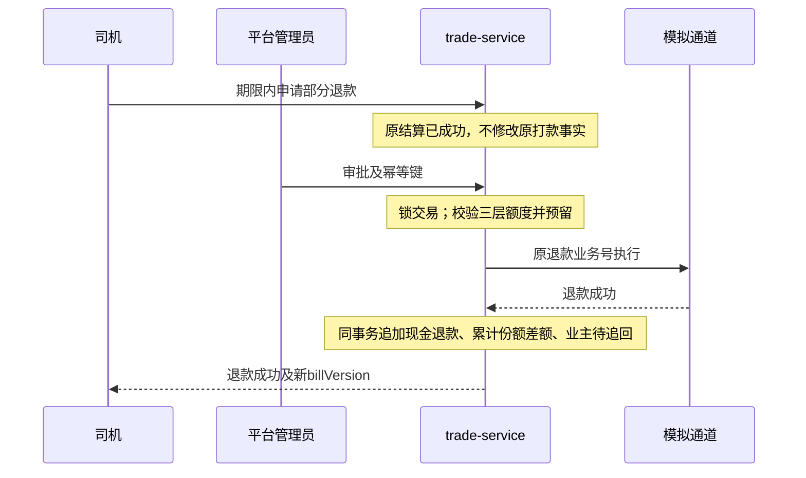

# 悦享泊智慧社区车位共享与结算平台总体设计说明书

版本：V1.1；日期：2026-10-16；基线：[项目计划 V2.2](./项目计划.md)。本次统一接口归属及标识，并补齐四条核心时序和失败恢复约束。

## 1. 文档目的与边界

本文确定系统结构、服务职责、核心流程和设计约束，作为七份 Markdown 设计文档的总入口。所有功能、表结构、接口和性能指标均为待实现设计，不代表已经开发或通过测试。本期为一名学生完成的毕业设计，16 周、400 小时，其中风险缓冲 40 小时。

系统面向司机、车位业主、物业管理员、平台管理员。交付查询预约、模拟停车、模拟支付退款、收益结算与对账闭环，以及自然语言找车位、规则问答、本人账单解释。使用虚拟数据，不接真实道闸、真实支付，不做自动定价、预测、自动追款和通用聊天。

| 文档 | 权威内容 |
|---|---|
| [需求规格说明书](./需求规格说明书.md) | 功能、业务规则、非功能要求及验收映射 |
| [特色功能详细设计说明书](./特色功能详细设计说明书.md) | AI 工具、检索、对话、降级与评测 |
| [数据库详细设计说明书](./数据库详细设计说明书.md) | 数据字典、约束、索引、事务与迁移 |
| [前端详细设计说明书](./前端详细设计说明书.md) | 页面、路由、组件、状态与交互 |
| [后端详细设计说明书](./后端详细设计说明书.md) | API、服务实现、事件、任务及安全 |
| [测试与部署设计说明书](./测试与部署设计说明书.md) | 用例、实验、环境、发布与恢复 |

需求变化先更新需求和计划，再同步相关设计及测试。原有六份 Word 文档为 V1.1 历史基线，本次七份 Markdown 文档承接计划V2.2；Word 尚未同步。本套规格保留FR01—FR17、NFR01—NFR07和原TC01—TC32，新增TC33—TC38、AT07—AT08及子用例，明确设计缺口的验证方法。

## 2. 总体架构

第一版使用三个业务服务。AI 独立代码模块初期部署于身份服务，通过独立执行资源、连接池和超时隔离；验证不达标时再拆独立进程。使用同一 MySQL 实例下的三个逻辑数据库和独立账号，禁止跨库查询。RabbitMQ 传递业务事实，Redis 用于限流、会话撤销和非权威缓存，不承担资金及车位占用的最终约束。

## 3. 技术选型及责任

| 层次 | 方案 | 使用目的 |
|---|---|---|
| 前端 | Vue 3、TypeScript、路由、集中状态管理、可复用管理组件 | 一套应用覆盖移动端业务页和桌面后台 |
| 服务 | Java 21、Spring Boot、Spring Cloud | 业务服务及注册发现 |
| 网关 | Gateway、LoadBalancer | 路由、身份初验、限流、追踪 |
| 持久化 | MySQL 8.4、版本化 SQL 迁移 | 本地事务、资金流水、预约锁定 |
| 异步 | RabbitMQ、Outbox | 可靠事件和异步补偿 |
| 运维 | Docker Compose、结构化日志、健康检查 | 单机毕业设计部署与复现 |
| AI | 模型 HTTP 适配器、数据库关键词检索 | 参数提取、依据检索和解释 |

2026-10-20 最小工程已验证并锁定 Spring Boot 4.0.8 / Spring Cloud 2025.1.3、JDK 21、Spring JDBC、Flyway 和 Vue/Element Plus，精确版本及结果见[环境配置与验证记录](./环境配置与验证记录.md)。容器使用镜像摘要，Cloud 组件由 BOM 管理。当前实现覆盖环境探针，业务服务和核心交易流程仍须按本文完成；不能将环境验证视为业务验收通过。

| 服务 | 持有业务事实 | 不承担的职责 |
|---|---|---|
| identity-service | 用户、角色、社区授权、通知、规则知识、AI 会话 | 不计算应收，不修改占用 |
| parking-service | 社区、车辆、车位、窗口、预约、入离场、价格规则快照 | 不直接更新支付退款状态 |
| trade-service | 应收账单、支付尝试、通道收款事实、退款、结算、对账 | 不直接释放或恢复停车占用 |

### 3.1 API与跨服务查询归属

| 接口组 | 所属服务／组合方式 |
|---|---|
| 登录、用户角色、社区管理员授权、消息、AI、知识 | identity-service；授予社区权限前通过parking内部接口验证社区 |
| 社区实体、车辆、车位、共享窗口、预约和入离场 | parking-service；敏感写入前向identity校验当前身份与范围 |
| 账单、支付、退款、结算和对账 | trade-service；从可靠停车事件维护履约投影，必要时查询parking内部快照恢复 |
| 审计 | 三个服务各自保存；网关将固定identity/parking/trade路径映射到对应服务；前端分标签分页 |
| 统计 | 停车订单量由parking提供，净实收及业主账面份额变动由trade提供；卡片独立标注asOf，不作跨库事务快照承诺 |

路由明细与所属服务列见后端文档。不存在泛化的“按用户传入URL访问服务”接口。前端不直接访问内部API。用于敏感写操作的同步授权校验发生在业务事务外，避免持行锁进行网络等待；已受理的在途事务与后续账号禁用之间按校验时点和审计记录界定，不承诺跨服务全局瞬时中止。

用户业务标识统一为reservationId；tradeOrderId、paymentOrderId和paymentAttemptId分别代表交易聚合、应收单及通道尝试，不互换。

## 4. 领域关系与不变量

一个车位属于一个社区和一个业主；一个共享窗口属于一个车位。一个预约关联司机、车辆、窗口、车位及快照。每个预约最多一个交易聚合；交易包含预约费、可选超时费两个应收单，并可有多次支付尝试。退款可拆到多个成功收款流水，每笔均受可退额度约束。每个交易最多一个普通结算项，结算后退款使用追加调整流水。

必须始终成立：

1. 同一车位重叠有效预约最多一个；同一车辆重叠有效预约最多一个。
2. 同一车位物理入场占用最多一个，不能因预约到期自动清除尚未离场车辆。
3. 金额以分为整数；净实收等于平台累计份额加业主累计份额。
4. 成功退款加在途预留不得大于实际成功收款；订单、每笔收款和本次批准退款目标分别检查，退款重试链不得分叉。
5. 已关闭预约不因迟到收款恢复；真实成功收款不能因事件顺序而丢失。
6. 用户身份来自验证后的令牌与服务端状态；模型、前端 userId 和菜单均不能授权。
7. CREATED/SUBMITTED/UNKNOWN支付尝试均占用唯一活动资格；崩溃恢复复用原业务号，确定失败后才能新建尝试。
8. 未成功结算的重试按当前账单重核金额；已成功结算金额不可覆盖，退款采用追加调整。

## 5. 关键流程

### 5.1 预约与预付

停车服务在本地事务内校验车辆、车位与窗口，按车辆、车位顺序锁定后检查区间冲突，创建待支付预约、价格快照及 Outbox。交易服务消费预约创建事件，幂等生成交易与预约费应收单。用户可见“账单准备中”，无需跨服务分布式事务。

模拟通道成功事实经交易服务核验后入账并持久发布事件。停车服务在占用截止前、订单未关闭时确认预约；确认失败发出退款补偿事件。前端区分支付成功和预约已确认。到期任务延迟不延长预约占用权利。

### 5.2 停车、账单与结算

物业在所属社区提交幂等事件；入场核对预约、车辆和物理占用，离场生成计费事实并释放物理占用。停车服务按快照计算超时秒数，交易服务按同一快照规则计算应收并校验事件。结算必须等待停车完成、全部应收结清、无退款预留、未决争议及对账差异。

### 5.3 退款与补偿

主动取消、司机未到场、车位无法履约均按本期规则全退可退余额，但保留不同业务原因。争议部分退款经平台审批，先预留额度，再调用模拟通道。未知结果查询原业务号；确定失败才释放对应预留。结算后退款追加负向调整和业主待追回记录。

### 5.4 AI 协助

AI 只调用查车位、检索规则、本人账单三个只读工具。后端返回真实候选和费用，前端使用结构化卡片；用户进入预约确认页后重新校验。规则问答附版本来源，历史账单使用订单规则快照。AI 失败不影响普通流程。

### 5.5 预约支付时序

任意事务后进程崩溃，由持久记录恢复；派发与网络调用不在事务锁内。任务租约过期只允许恢复原业务号。

### 5.6 取消退款时序

### 5.7 离场补缴时序

### 5.8 结算后退款时序

若打款仍未知则暂不执行退款；若打款确定失败，先恢复UNSETTLED并处理争议，后续结算用新净额，不能套用“结算后追回”分支。

## 6. 跨服务一致性与安全

本地事务保存业务及 Outbox，发布确认后标记发送成功；消费业务和去重记录同事务提交后确认消息。接受至少一次投递，通过 eventId 和业务唯一键避免重复作用。失败发布、消费死信及通道未知结果分别恢复。

每个服务验证令牌签名、时效、签发者、受众及授权范围。敏感写操作还检查账号当前启用状态及当前权限；身份状态依赖不可用时拒绝敏感写入，不使用失效缓存放行。服务间接口不暴露公网，验证服务凭据与原用户上下文，拒绝客户端伪造身份头。消息生产者通过代理权限限制，消费者校验来源、类型与业务归属。

## 7. 容量、部署与演进

基准为 4 核、16 GB、SSD；3 个社区、300 个车位、1000 个用户、10000 条历史订单。基础业务 50 并发，查询 P95≤1 秒，预约 P95≤2 秒，非预期错误率<1%。这些是待测目标，不是容量承诺。

单机 Compose 交付覆盖前端、网关、Eureka、三个服务、MySQL、Redis、RabbitMQ。业务数据使用持久卷；公网只暴露 Web/网关入口。AI 外网故障有明确降级，数据库故障拒绝产生虚假成功。备份和恢复演练是交付要求；单机部署不宣称高可用。

第 4 周形成简化端到端流程，第 12 周冻结功能；后续可选扩展先评估工时和数据。保留 AI 独立部署、真实支付适配和地图接入接口，但不预先实现。

## 8. 设计依据

- [Spring Cloud 官方兼容说明](https://spring.io/projects/spring-cloud/)
- [RabbitMQ 发布确认与消费确认](https://www.rabbitmq.com/docs/confirms)
- [项目计划](./项目计划.md)中的业务与验收基线

## 第5—6周阶段实现补充（2026-10-24）

继续复用identity/parking/trade服务及现有Vue入口，不跨库写入。授权变更使用身份库全局授权锁与版本比较；保留社区级预约锁，容量优化延至第7—8周。

当前接口和兼容规则见[第5—6周业务契约](docs/contracts/业务契约-第5—6周.md)，需求追踪见[阶段基线](docs/第5—6周需求与实施基线.md)，当次验证以[验收记录](第5—6周实施与验收记录.md)为准。以上补充描述本阶段实现，前文完整目标设计保留，不能据此宣称后续功能完成。
