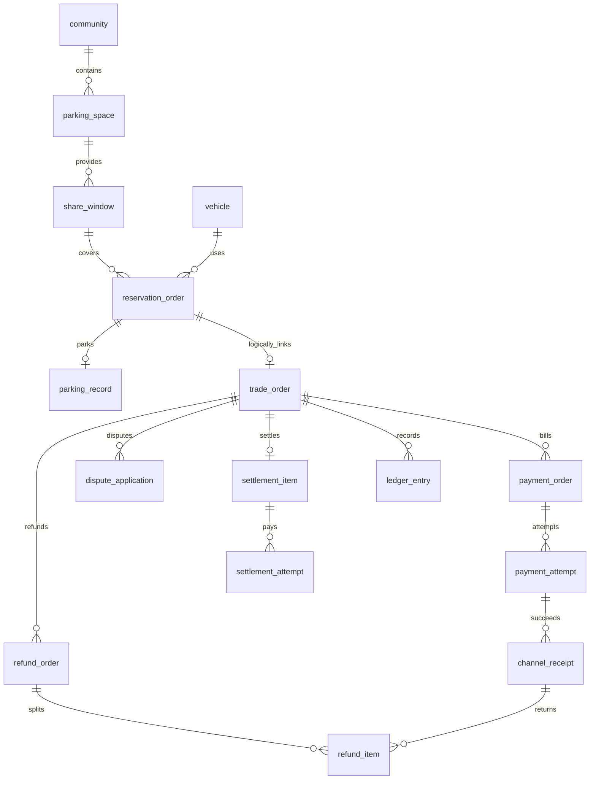

# 智慧社区停车位共享与结算系统数据库详细设计说明书

版本：V1.1；日期：2026-10-16；依据：[需求规格说明书](./需求规格说明书.md)、[后端详细设计说明书](./后端详细设计说明书.md)。本次补齐活动尝试、派发租约、退款父额度、重试链和知识主记录；核心资金表改为逐字段字典。迁移脚本尚待实现。

## 1. 存储规范

MySQL 8.4、InnoDB、utf8mb4。identity_db、parking_db、trade_db分别由所属服务账号访问，不跨库JOIN或建立跨库外键。每个服务的迁移单独版本化。同库引用字段按下述关系进行存在性校验；可建立无级联删除的外键，循环引用由事务约束处理。资金、订单和审计禁止物理删除。

所有业务表默认包含：`id BIGINT UNSIGNED PRIMARY KEY`、`created_at DATETIME(3) NOT NULL`、`updated_at DATETIME(3) NOT NULL`、`version BIGINT NOT NULL DEFAULT 0`。ID由应用统一生成；API用字符串，避免JavaScript整数精度丢失。下面不重复列公共字段，追加事实表的updated_at不用于修改事实。

时间全部UTC；金额字段使用BIGINT整数分，不使用浮点。业务金额非负，ledger_entry.amount_fen为有符号变动额。比例使用`INT`基点，0—10000，默认1000。`?`表示允许NULL，其他字段默认NOT NULL；状态为VARCHAR(32)，使用CHECK和应用枚举约束。JSON只能保存快照和扩展数据，核心筛选字段独立列出。字段长度限制同时在API执行。

## 2. 关系概览



预约与交易跨库关系为逻辑关联，通过reservation_id和事件维护。payment_attempt与channel_receipt不是一对一假设：异常多次成功回调若具有不同通道交易号，仍需保存事实并补偿。

## 3. identity_db数据字典

| 表 | 专有字段（名称 类型） | 约束与索引 |
|---|---|---|
| user | login_name VARCHAR(64)，password_hash VARCHAR(255)，display_name VARCHAR(64)，phone_cipher VARCHAR(512)?，status VARCHAR(16)，auth_version BIGINT | UNIQUE(login_name)；status为ENABLED/DISABLED；密码不可逆哈希，手机号如使用则加密 |
| role | code VARCHAR(32)，name VARCHAR(64)，permissions_json JSON | UNIQUE(code)；DRIVER/OWNER/PROPERTY/PLATFORM四类；权限代码由版本化配置维护 |
| user_role | user_id BIGINT UNSIGNED，role_id BIGINT UNSIGNED | UNIQUE(user_id,role_id)，INDEX(role_id)；引用user、role |
| community_admin | community_id BIGINT UNSIGNED，user_id BIGINT UNSIGNED，status VARCHAR(16) | UNIQUE(community_id,user_id)，INDEX(user_id,status)；社区为跨库ID，授予时验证存在 |
| notification | user_id BIGINT UNSIGNED，event_id VARCHAR(64)，type VARCHAR(32)，title VARCHAR(128)，content VARCHAR(1000)，biz_ref VARCHAR(64)，read_at DATETIME(3)? | UNIQUE(user_id,event_id,type)，INDEX(user_id,created_at,id)；消息正文最小化 |
| knowledge_rule | rule_id VARCHAR(64)，community_id BIGINT UNSIGNED | UNIQUE(rule_id,community_id)；稳定主记录用于串行版本发布，community_id=0为全局 |
| knowledge_entry | rule_id VARCHAR(64)，rule_version INT，title VARCHAR(128)，topic VARCHAR(32)，keywords_json JSON，content TEXT，community_id BIGINT UNSIGNED，effective_at DATETIME(3)，expires_at DATETIME(3)?，status VARCHAR(16)，published_by BIGINT UNSIGNED? | UNIQUE(rule_id,rule_version,community_id)，INDEX(topic,community_id,status,effective_at)；逻辑引用knowledge_rule(rule_id,community_id) |
| ai_session | user_id BIGINT UNSIGNED，intent VARCHAR(32)，slots_json JSON，task_turns INT，status VARCHAR(16)，last_active_at DATETIME(3)，expires_at DATETIME(3)，active_request_id VARCHAR(64)?，processing_token VARCHAR(64)?，processing_lease_until DATETIME(3)? | INDEX(user_id,last_active_at,id)，INDEX(expires_at)，INDEX(status,processing_lease_until)；公共version为对话版本，只保存当前任务槽位 |
| ai_message | session_id BIGINT UNSIGNED，user_id BIGINT UNSIGNED，request_id VARCHAR(64)，request_key VARCHAR(64)，sequence_no INT，role VARCHAR(16)，content TEXT，result_json JSON?，status VARCHAR(16) | UNIQUE(session_id,sequence_no)，UNIQUE(session_id,request_key,role)，UNIQUE(session_id,request_id,role)；结果须脱敏，归属同时核对session |
| ai_call_log | session_id BIGINT UNSIGNED?，request_id VARCHAR(64)，trace_id VARCHAR(64)，intent VARCHAR(32)，model VARCHAR(128)，prompt_version VARCHAR(32)，knowledge_versions_json JSON，tool_name VARCHAR(64)?，duration_ms INT，input_tokens INT?，output_tokens INT?，cost_microyuan BIGINT?，result_status VARCHAR(32)，fallback_reason VARCHAR(64)? | INDEX(trace_id)，INDEX(created_at,result_status)；cost_microyuan为百万分之一元，用于估算且允许未知，不与停车资金字段混用 |

knowledge_entry状态DRAFT/PUBLISHED/DISABLED。发布后正文不可覆盖；同rule_id、同community_id版本有效期不得重叠，采用[effective_at,expires_at)，结束为空视为无限。主题不参与排他约束，不同rule_id同主题可以并存。首次建规则先通过唯一键创建或取得knowledge_rule，发布时锁主记录并检查版本，不能仅锁不存在的版本行。历史版本保留。没有发布人的草稿published_by为空。权限变更递增auth_version。

ai_session状态READY/PROCESSING/CLOSED；版本初始0，受理时按版本和READY原子设置请求及token，写回或崩溃接管时版本加1。ai_message.status为PROCESSING/SUCCEEDED/FAILED，role为USER/ASSISTANT；每轮最多各一条记录，工具轨迹存ai_call_log。处理中幂等键保存request_id，终结结果与消息、槽位同事务更新；租约过期后旧token不能写回。

## 4. parking_db数据字典

| 表 | 专有字段 | 约束与索引 |
|---|---|---|
| community | name VARCHAR(128)，address VARCHAR(255)，contact_cipher VARCHAR(512)?，status VARCHAR(16) | INDEX(status,name)；名称可重名，前端须显示地址协助选择 |
| vehicle | user_id BIGINT UNSIGNED，plate_norm VARCHAR(32)，vehicle_type VARCHAR(32)，status VARCHAR(16) | UNIQUE(plate_norm)，INDEX(user_id,status)；首版同车牌只绑定一个账号，转移归属不在本期范围 |
| parking_space | community_id BIGINT UNSIGNED，owner_id BIGINT UNSIGNED，space_code VARCHAR(64)，location_desc VARCHAR(255)，space_type VARCHAR(32)，proof_text VARCHAR(1000)，review_status VARCHAR(16)，review_comment VARCHAR(500)?，reviewed_by BIGINT UNSIGNED?，reviewed_at DATETIME(3)?，status VARCHAR(16)，current_reservation_id BIGINT UNSIGNED? | UNIQUE(community_id,space_code)，INDEX(owner_id,status)，INDEX(community_id,review_status,status,space_type)；current_reservation_id为当前物理占用 |
| share_window | space_id BIGINT UNSIGNED，start_at DATETIME(3)，end_at DATETIME(3)，hourly_price_fen BIGINT，status VARCHAR(16) | INDEX(space_id,status,start_at,end_at)；start<end、单价>0，重叠由车位行锁校验 |
| reservation_order | 逐字段定义见第9节 reservation_order | UNIQUE(order_no)，INDEX(space_id,status,start_at,end_at)，INDEX(vehicle_id,status,start_at,end_at)，INDEX(user_id,created_at,id)，INDEX(status,pay_deadline)，INDEX(status,start_at) |
| parking_record | reservation_id BIGINT UNSIGNED，space_id BIGINT UNSIGNED，vehicle_id BIGINT UNSIGNED，entered_at DATETIME(3)，exited_at DATETIME(3)?，overtime_seconds BIGINT?，entry_event_id VARCHAR(64)，exit_event_id VARCHAR(64)? | UNIQUE(reservation_id)，UNIQUE(entry_event_id)，UNIQUE(exit_event_id)，INDEX(space_id,exited_at) |
| event_log | event_id VARCHAR(64)，reservation_id BIGINT UNSIGNED，space_id BIGINT UNSIGNED，event_type VARCHAR(32)，occurred_at DATETIME(3)，operator_id BIGINT UNSIGNED，result_code VARCHAR(64)，reason VARCHAR(500)?，request_hash CHAR(64) | UNIQUE(event_id)，INDEX(reservation_id,occurred_at)；包括ENTRY、EXIT、BLOCKED、UNAVAILABLE |

车位审核状态DRAFT/PENDING/APPROVED/REJECTED，启用状态ENABLED/DISABLED。窗口ACTIVE/DISABLED。预约WAIT_PAY/CONFIRMED/IN_USE/COMPLETED/CLOSED。车辆ENABLED/DISABLED。event_log中的受阻事件是事实，不能被后续成功入场覆盖。

不使用“车位+开始时间唯一”代替区间冲突校验。物理占用由锁定parking_space后检查和更新current_reservation_id保证；入离场记录与指针同事务更新。有效预约包含未过期WAIT_PAY、CONFIRMED和IN_USE，结束时间已过但车辆未出场的物理占用另行阻断入场。

## 5. trade_db数据字典

### 5.1 交易、应收和成功事实

| 表 | 专有字段 | 约束与索引 |
|---|---|---|
| trade_order | 逐字段定义见第9节 trade_order | UNIQUE(reservation_id)，INDEX(user_id,created_at,id)，INDEX(owner_id,settlement_status)，所有累计金额非负；refunded+reserved≤paid |
| payment_order | 逐字段定义见第9节 payment_order | UNIQUE(trade_order_id,bill_type)；bill_type为PREPAY/OVERTIME；due_fen>0 |
| payment_attempt | 逐字段定义见第9节 payment_attempt | UNIQUE(payment_order_id,attempt_no)，UNIQUE(channel,channel_request_no)，INDEX(status,next_query_at)；INDEX(status,next_dispatch_at)，INDEX(dispatch_lease_until) |
| channel_receipt | 逐字段定义见第9节 channel_receipt | UNIQUE(channel,channel_tx_no)，INDEX(trade_order_id)；收到的成功事实不可删除；refunded+reserved≤received |

payment_order状态UNPAID/PAID/CLOSED；payment_attempt状态CREATED/SUBMITTED/UNKNOWN/SUCCEEDED/FAILED。成功事实以channel_receipt为准，attempt状态不能代替流水。已PAID应收单如发生退款仍保留支付历史；通过trade_order和退款明细表达净额，不错误地要求再补缴已批准退款部分。

parking_snapshot保存预约起止、地点摘要、已知入离场及超时秒数，由停车事件维护；projection_updated_at为最近同步时间。停车状态投影按parking_version更新，资金事实独立按业务号处理，不能共用版本过滤而漏记旧回调。rule_snapshot冻结计费、取消、超时及服务费规则内容，不能只保存可变知识条目ID。

### 5.2 争议与退款

| 表 | 专有字段 | 约束与索引 |
|---|---|---|
| dispute_application | trade_order_id BIGINT UNSIGNED，user_id BIGINT UNSIGNED，amount_fen BIGINT，reason VARCHAR(500)，evidence_text TEXT，facts_hash CHAR(64)，previous_application_id BIGINT UNSIGNED?，status VARCHAR(32)，decision_by BIGINT UNSIGNED?，decision_note VARCHAR(500)?，decided_at DATETIME(3)? | INDEX(trade_order_id,status)，INDEX(user_id,created_at)；同时一个未决申请由trade_order锁保证；事实重复在锁下判断 |
| refund_order | 逐字段定义见第9节 refund_order | UNIQUE(refund_no)，UNIQUE(application_id)，INDEX(trade_order_id,status)；自动退款application_id为空 |
| refund_item | 逐字段定义见第9节 refund_item | UNIQUE(channel,channel_refund_no)，INDEX(refund_order_id,status)，INDEX(channel_receipt_id,status)，INDEX(status,next_query_at)；INDEX(status,next_dispatch_at)，INDEX(dispatch_lease_until)；UNIQUE(retry_of_item_id)，UNIQUE(successor_item_id) |

申请状态PENDING/APPROVED/REJECTED/EXECUTING/COMPLETED，APPROVED和EXECUTING仍为未决。refund_order状态PENDING/PROCESSING/UNKNOWN/PARTIAL/SUCCEEDED/FAILED；父状态根据明细计算并缓存，UNKNOWN表示至少一项未知且尚未全部成功。refund_item状态RESERVED/SUBMITTED/UNKNOWN/SUCCEEDED/FAILED。

失败项原记录保留，重试创建新项并关联retry_of_item_id，先重新预留；不能重试成功项或结果未知项。父目标不随重试增长，累计成功金额不超过target_fen。自动全退应对本次可退收款逐笔分配；多收补偿指定多收receipt，不能误退正常预约款。金额预留在聚合和receipt上同步更新。

### 5.3 结算、账务和对账

| 表 | 专有字段 | 约束与索引 |
|---|---|---|
| settlement_batch | batch_no VARCHAR(64)，scope_json JSON，requested_by BIGINT UNSIGNED，status VARCHAR(16)，finished_at DATETIME(3)? | UNIQUE(batch_no)，INDEX(created_at,status)；范围为执行请求，不是金额事实 |
| settlement_item | 逐字段定义见第9节 settlement_item | UNIQUE(trade_order_id)，INDEX(batch_id,status)，INDEX(owner_id,created_at)；普通结算只一个，失败重试复用该项 |
| settlement_attempt | 逐字段定义见第9节 settlement_attempt | UNIQUE(settlement_item_id,attempt_no)，UNIQUE(payout_no)，UNIQUE(channel_tx_no)，INDEX(status,next_query_at)；INDEX(status,next_dispatch_at)，INDEX(dispatch_lease_until) |
| ledger_entry | trade_order_id BIGINT UNSIGNED，owner_id BIGINT UNSIGNED，entry_type VARCHAR(32)，source_type VARCHAR(32)，source_id BIGINT UNSIGNED，amount_fen BIGINT，occurred_at DATETIME(3)，trace_id VARCHAR(64) | UNIQUE(source_type,source_id,entry_type)，INDEX(trade_order_id,occurred_at,id)，INDEX(owner_id,entry_type,occurred_at)；仅追加 |
| reconciliation_issue | trade_order_id BIGINT UNSIGNED，rule_code VARCHAR(64)，status VARCHAR(16)，expected_json JSON，actual_json JSON，last_checked_at DATETIME(3)，handled_by BIGINT UNSIGNED?，handling_note VARCHAR(1000)?，resolved_at DATETIME(3)? | UNIQUE(trade_order_id,rule_code)，INDEX(status,last_checked_at)；重复检测更新当前差异并追加审计 |

trade_order结算状态UNSETTLED/SETTLING/SETTLED；settlement_item状态PENDING/PROCESSING/UNKNOWN/SUCCEEDED/FAILED；attempt状态CREATED/SUBMITTED/UNKNOWN/SUCCEEDED/FAILED；批次状态PENDING/PROCESSING/PARTIAL/SUCCEEDED/FAILED。一个批次允许不同条目不同结果，不能以批次成功覆盖未知项。

ledger_entry类型CASH_RECEIPT、CASH_REFUND、PLATFORM_SHARE、OWNER_SHARE、OWNER_PAYOUT、OWNER_RECOVERABLE。收款现金为正、退款现金为负；平台和业主份额记录累计值差额；打款记录实际支出，待追回记录应收回金额。不同类型分组核对，不能把所有amount_fen直接相加当成账户余额。本期为业务分类流水，不宣称实现银行级复式总账。

例如实收1000分，记录平台份额+100、业主份额+900；结算成功记录OWNER_PAYOUT 900。退款200分后记录CASH_REFUND -200、平台份额-20、业主份额-180、OWNER_RECOVERABLE +180。净实收800=平台80+业主720，原打款900保留。

### 5.4 模拟通道持久记录

演示配置启用`simulated_channel_operation`：operation_type VARCHAR(16)（PAY/REFUND/PAYOUT）、request_no VARCHAR(64)、amount_fen BIGINT、status VARCHAR(16)、channel_tx_no VARCHAR(64)?、scenario VARCHAR(32)、result_available_at DATETIME(3)?、callback_count INT、result_json JSON?，另含公共字段。UNIQUE(operation_type,request_no)、UNIQUE(channel_tx_no)，INDEX(status,result_available_at)。

该表独立保存模拟通道事实，状态PENDING/SUCCEEDED/FAILED；UNKNOWN是业务调用方不知道结果的状态，不覆盖通道已知结果。通道操作与业务账务使用不同事务，能够模拟通道成功但回调丢失。异常额外成功收款作为独立通道事实登记，再关联原支付尝试；正常业务不允许主动重复扣款。模拟器可使用独立operation记录表示额外事实，并通过result_json保存原请求关联。该表随交易库备份，不允许正常用户修改故障场景。

## 6. 各服务公共表

下列表在三个逻辑库分别创建，仅保存本服务数据，不共享跨库事务。

| 表 | 专有字段 | 约束与索引 |
|---|---|---|
| idempotency_record | actor_id BIGINT UNSIGNED，operation VARCHAR(64)，request_key VARCHAR(64)，request_hash CHAR(64)，status VARCHAR(16)，business_ref VARCHAR(64)?，response_json JSON?，expires_at DATETIME(3)? | UNIQUE(actor_id,operation,request_key)；资金业务引用长期保留；响应正文不存密钥 |
| outbox_event | event_id VARCHAR(64)，event_type VARCHAR(64)，schema_version INT，aggregate_id VARCHAR(64)，aggregate_version BIGINT，payload JSON，status VARCHAR(16)，retry_count INT，next_retry_at DATETIME(3)?，lease_until DATETIME(3)?，published_at DATETIME(3)?，last_error VARCHAR(500)? | UNIQUE(event_id)，INDEX(status,next_retry_at)，INDEX(lease_until) |
| consumed_event | consumer_name VARCHAR(64)，event_id VARCHAR(64)，processed_at DATETIME(3) | UNIQUE(consumer_name,event_id)；与消费业务同事务提交 |
| audit_log | actor_id BIGINT UNSIGNED?，actor_type VARCHAR(16)，operation VARCHAR(64)，target_type VARCHAR(64)，target_id VARCHAR(64)，result_code VARCHAR(64)，reason VARCHAR(1000)?，before_json JSON?，after_json JSON?，trace_id VARCHAR(64) | INDEX(target_type,target_id,created_at)，INDEX(actor_id,created_at)，INDEX(trace_id)；敏感字段脱敏 |

Outbox状态PENDING/PUBLISHING/SENT/FAILED，发布中崩溃由lease_until到期重新领取。consumed_event只代表成功消费，不提前插入并提交“已处理”。资金事件去重记录不可在仍可能重放期间清除。

## 7. 核心事务与索引使用

### 7.1 预约冲突

以下为事务伪SQL，实施时参数化执行，不直接拼接用户输入。所有影响占用的写入必须遵循相同锁规则：

```sql
START TRANSACTION;
SELECT id FROM vehicle WHERE id = :vehicleId FOR UPDATE;
SELECT id, current_reservation_id FROM parking_space
 WHERE id = :spaceId FOR UPDATE;
SELECT id FROM reservation_order
 WHERE space_id = :spaceId
   AND start_at < :newEnd AND end_at > :newStart
   AND (status IN ('CONFIRMED','IN_USE')
        OR (status = 'WAIT_PAY' AND pay_deadline > :now))
 FOR UPDATE;
-- 车辆维度执行同样的当前读冲突检查，完成窗口、权限校验后写预约及Outbox。
COMMIT;
```

没有冲突记录时也靠稳定存在的车位和车辆行串行化竞争，不能只锁不存在的预约行。选择性查询先按车位、状态和时间过滤；窗口修改同样锁车位。入离场仅需车位→预约，禁止反向获取车辆锁。

### 7.2 退款与结算

退款统一锁顺序为trade_order→refund_order→channel_receipt（主键升序）→refund_item（主键升序）。不存在的父退款先在trade_order锁下创建。检查订单、单笔收款、本次批准退款三层额度，更新全部预留与明细，写Outbox后提交。回调和重试使用相同顺序。结算先锁trade_order，再锁settlement_item及attempt；跨订单批次逐项事务执行，不在锁内调用通道。

退款必须保证refund_order.succeeded_fen + refund_order.reserved_fen ≤ target_fen，且reserved_fen等于本父单所有RESERVED/SUBMITTED/UNKNOWN明细预留之和。重复重试沿唯一后继链复用已创建项；UNIQUE(retry_of_item_id)防止同一失败项分叉，successor_item_id一经写入不清除。成功和确定失败分别同步结转／释放三层预留，不能只更新trade_order。

结算处理中争议可创建PENDING，但不能审批执行退款；待打款确定后再处理。多表金额CHECK只能验证单行，跨行合计仍须事务锁、幂等和对账验证。

### 7.3 固定对账规则

R01：成功收款合计等于trade_order.paid_fen；R02：成功退款合计等于refunded_fen；R03：活动明细预留分别等于交易、receipt和refund_order的预留；R04：净实收等于平台与业主份额；R05：成功打款等于成功尝试与结算项金额（零额结算无通道流水）；R06：关闭预约未补偿收款、额外收款和未知结果进入待处理检查；R07：每父退款成功加预留不超过target_fen且不存在分叉重试；R08：活动支付／结算指针与未结束尝试一致。差异阻断结算，复查通过才解除，不能直接改历史流水。

## 8. 迁移、种子数据与保留

每服务使用顺序迁移，工具已通过最小工程确定为 Flyway。parking-service 的环境验证 V001 位于 `db/probe`，内容保持不变，仅在 `probe` 配置启用；正式业务迁移使用独立目录和各服务业务库，不能将环境探针迁移自动带入业务环境。如果沿用已存在的验证库，须先明确历史基线与迁移编号，不能另写同号 V001。其他服务各自从独立历史开始，详见[工程优化与验证记录](./工程优化与验证记录.md)。已执行迁移不改写，新变更新增版本。演示数据与结构迁移分开，只有演示环境显式导入；数据库名、账号和密码来自配置，不硬编码。

种子包含四角色、角色权限、3社区、300车位、1000虚拟用户及10000历史订单。性能数据必须同时生成对应车辆、窗口、账单和流水，不能只插入订单使对账天然错误。每次压测可从固定快照复位。

AI会话和消息默认30天清理；AI调用统计可保存脱敏汇总。业务、资金和审计本期保留，不随账号禁用或会话清理删除。清理程序按批处理并保留删除数量；手机号、车牌不进入日志和模型上下文。

备份与恢复以三个库的业务一致性为目标。毕业设计采用维护窗口停止写入和资金任务、排空或登记未处理事件后执行备份；恢复后启动前运行对账和任务恢复核查。具体步骤见测试与部署文档。未执行恢复验证的备份不能认定可用。

## 9. 核心表逐字段定义

所有下表同时包含公共id、created_at、updated_at、version。默认值“—”表示无数据库默认，插入时必须明确提供；“NULL”表示可空缺省；JSON快照由应用明确构造，不使用空对象冒充已核实事实。状态转换规则以正文及后端状态机为准。

| 公共字段 | 类型 | 可空 | 默认／赋值 | 含义 |
|---|---|---|---|---|
| id | BIGINT UNSIGNED | 否 | 应用生成 | 主键，API字符串 |
| created_at | DATETIME(3) | 否 | 应用UTC时间 | 创建时间 |
| updated_at | DATETIME(3) | 否 | 应用UTC时间 | 本行最近变更时间 |
| version | BIGINT | 否 | 0 | 乐观并发版本；AI会话另按其协议递增 |

### 9.1 reservation_order

| 字段 | 类型 | 可空 | 默认值 | 含义与约束 |
|---|---|---|---|---|
| order_no | VARCHAR(64) | 否 | — | 对用户展示的预约编号，不用作资源主键 |
| user_id | BIGINT UNSIGNED | 否 | — | 所属司机／用户身份 |
| vehicle_id | BIGINT UNSIGNED | 否 | — | 本人启用车辆主键 |
| space_id | BIGINT UNSIGNED | 否 | — | 车位主键 |
| window_id | BIGINT UNSIGNED | 否 | — | 覆盖完整预约的共享窗口 |
| community_id | BIGINT UNSIGNED | 否 | — | 社区范围快照 |
| owner_id | BIGINT UNSIGNED | 否 | — | 车位业主身份快照 |
| start_at | DATETIME(3) | 否 | — | 预约开始UTC时间 |
| end_at | DATETIME(3) | 否 | — | 预约结束UTC时间 |
| pay_deadline | DATETIME(3) | 否 | — | 待支付截止，达到即不能确认 |
| status | VARCHAR(16) | 否 | WAIT_PAY | 状态枚举，取值及转换见正文 |
| close_reason | VARCHAR(32) | 是 | NULL | 关闭原因枚举 |
| hourly_price_fen | BIGINT | 否 | — | 冻结小时单价，正整数分 |
| fee_rate_bps | INT | 否 | 1000 | 冻结服务费比例，0至10000 |
| prepay_fen | BIGINT | 否 | — | 预约应收整数分 |
| vehicle_snapshot | JSON | 否 | — | 下单时车辆快照，不随车辆变更 |
| rule_version | VARCHAR(32) | 否 | — | 冻结的业务规则版本标识 |
| rule_snapshot | JSON | 否 | — | 冻结规则内容及条款引用 |
| confirmed_at | DATETIME(3) | 是 | NULL | 预约确认成功时间 |
| closed_at | DATETIME(3) | 是 | NULL | 预约关闭时间 |

约束与索引：UNIQUE(order_no)，INDEX(space_id,status,start_at,end_at)，INDEX(vehicle_id,status,start_at,end_at)，INDEX(user_id,created_at,id)，INDEX(status,pay_deadline)，INDEX(status,start_at)。

### 9.2 trade_order

| 字段 | 类型 | 可空 | 默认值 | 含义与约束 |
|---|---|---|---|---|
| reservation_id | BIGINT UNSIGNED | 否 | — | 跨库预约主键，外部统一reservationId |
| user_id | BIGINT UNSIGNED | 否 | — | 所属司机／用户身份 |
| owner_id | BIGINT UNSIGNED | 否 | — | 车位业主身份快照 |
| community_id | BIGINT UNSIGNED | 否 | — | 社区范围快照 |
| parking_status | VARCHAR(16) | 否 | WAIT_PAY | 停车领域状态投影 |
| parking_version | BIGINT | 否 | 0 | 最后接收的停车聚合版本 |
| parking_snapshot | JSON | 否 | — | 时段、地点、入离场等履约快照 |
| projection_updated_at | DATETIME(3) | 否 | — | 最后同步停车投影的时间 |
| reservation_closed | BOOLEAN | 否 | FALSE | 是否已接收到关闭事实 |
| bill_version | BIGINT | 否 | 0 | 账单事实版本，相关更新同事务递增 |
| hourly_price_fen | BIGINT | 否 | — | 冻结小时单价，正整数分 |
| fee_rate_bps | INT | 否 | 1000 | 冻结服务费比例，0至10000 |
| rule_version | VARCHAR(32) | 否 | — | 冻结的业务规则版本标识 |
| rule_snapshot | JSON | 否 | — | 冻结规则内容及条款引用 |
| paid_fen | BIGINT | 否 | 0 | 累计真实成功收款 |
| refunded_fen | BIGINT | 否 | 0 | 累计成功退款 |
| reserved_refund_fen | BIGINT | 否 | 0 | 当前在途退款预留 |
| platform_share_fen | BIGINT | 否 | 0 | 平台累计应得份额 |
| owner_share_fen | BIGINT | 否 | 0 | 业主累计应得份额 |
| settlement_status | VARCHAR(16) | 否 | UNSETTLED | 交易结算资格／执行状态 |
| reconciliation_blocked | BOOLEAN | 否 | FALSE | 存在未解决对账差异 |
| excess_payment_blocked | BOOLEAN | 否 | FALSE | 存在未完成多收补偿 |
| parking_completed_at | DATETIME(3) | 是 | NULL | 停车完成事实时间 |
| reservation_closed_at | DATETIME(3) | 是 | NULL | 预约关闭事实时间 |

约束与索引：UNIQUE(reservation_id)，INDEX(user_id,created_at,id)，INDEX(owner_id,settlement_status)，所有累计金额非负；refunded+reserved≤paid。

### 9.3 payment_order

| 字段 | 类型 | 可空 | 默认值 | 含义与约束 |
|---|---|---|---|---|
| trade_order_id | BIGINT UNSIGNED | 否 | — | 所属交易聚合主键 |
| bill_type | VARCHAR(16) | 否 | — | PREPAY或OVERTIME |
| due_fen | BIGINT | 否 | — | 该应收单应付金额，大于0 |
| status | VARCHAR(16) | 否 | UNPAID | 状态枚举，取值及转换见正文 |
| settled_at | DATETIME(3) | 是 | NULL | 应收结清时间 |
| active_attempt_id | BIGINT UNSIGNED | 是 | NULL | 唯一未结束尝试指针，终结后清空 |

约束与索引：UNIQUE(trade_order_id,bill_type)；bill_type为PREPAY/OVERTIME；due_fen>0。

### 9.4 payment_attempt

| 字段 | 类型 | 可空 | 默认值 | 含义与约束 |
|---|---|---|---|---|
| payment_order_id | BIGINT UNSIGNED | 否 | — | 所属应收单 |
| attempt_no | INT | 否 | — | 父对象内单调递增尝试序号 |
| channel | VARCHAR(32) | 否 | — | 模拟通道标识 |
| channel_request_no | VARCHAR(64) | 否 | — | 不可变扣款幂等业务号 |
| requested_fen | BIGINT | 否 | — | 本次尝试不可变金额 |
| status | VARCHAR(16) | 否 | CREATED | 状态枚举，取值及转换见正文 |
| next_query_at | DATETIME(3) | 是 | NULL | 下次未知结果查询时间 |
| query_count | INT | 否 | 0 | 已经执行的查询次数 |
| needs_manual_review | BOOLEAN | 否 | FALSE | 自动恢复耗尽后置真，保持活动资格或退款预留 |
| last_error | VARCHAR(500) | 是 | NULL | 脱敏的最近错误摘要 |
| dispatch_token | VARCHAR(64) | 是 | NULL | 本轮任务领取标识，用于隔离旧执行者 |
| dispatch_lease_until | DATETIME(3) | 是 | NULL | 领取租约截止UTC时间 |
| next_dispatch_at | DATETIME(3) | 是 | NULL | 待派发／接管任务的下次执行时间 |

约束与索引：UNIQUE(payment_order_id,attempt_no)，UNIQUE(channel,channel_request_no)，INDEX(status,next_query_at)；INDEX(status,next_dispatch_at)，INDEX(dispatch_lease_until)。

### 9.5 channel_receipt

| 字段 | 类型 | 可空 | 默认值 | 含义与约束 |
|---|---|---|---|---|
| payment_attempt_id | BIGINT UNSIGNED | 否 | — | 原支付尝试关联 |
| trade_order_id | BIGINT UNSIGNED | 否 | — | 所属交易聚合主键 |
| channel | VARCHAR(32) | 否 | — | 模拟通道标识 |
| channel_tx_no | VARCHAR(64) | 否 | — | 通道真实成功交易号 |
| received_fen | BIGINT | 否 | — | 本笔真实成功收款金额 |
| refunded_fen | BIGINT | 否 | 0 | 累计成功退款 |
| reserved_refund_fen | BIGINT | 否 | 0 | 当前在途退款预留 |
| succeeded_at | DATETIME(3) | 否 | — | 确定成功事实时间 |
| verification_hash | CHAR(64) | 否 | — | 已验证回调摘要，不保存敏感凭据 |

约束与索引：UNIQUE(channel,channel_tx_no)，INDEX(trade_order_id)；收到的成功事实不可删除；refunded+reserved≤received。

### 9.6 refund_order

| 字段 | 类型 | 可空 | 默认值 | 含义与约束 |
|---|---|---|---|---|
| trade_order_id | BIGINT UNSIGNED | 否 | — | 所属交易聚合主键 |
| application_id | BIGINT UNSIGNED | 是 | NULL | 争议审批申请，自动补偿为空 |
| refund_no | VARCHAR(64) | 否 | — | 唯一父退款业务号 |
| reason_type | VARCHAR(32) | 否 | — | 取消、无法履约、争议或多收等原因 |
| target_fen | BIGINT | 否 | — | 本父退款批准目标，不随重试增加 |
| succeeded_fen | BIGINT | 否 | 0 | 本父退款累计成功金额 |
| status | VARCHAR(32) | 否 | PENDING | 状态枚举，取值及转换见正文 |
| reserved_fen | BIGINT | 否 | 0 | 当前活动退款预留；父项和明细分别汇总／持有 |

约束与索引：UNIQUE(refund_no)，UNIQUE(application_id)，INDEX(trade_order_id,status)；自动退款application_id为空。

### 9.7 refund_item

| 字段 | 类型 | 可空 | 默认值 | 含义与约束 |
|---|---|---|---|---|
| refund_order_id | BIGINT UNSIGNED | 否 | — | 所属父退款主键 |
| channel_receipt_id | BIGINT UNSIGNED | 否 | — | 被退的真实收款事实 |
| retry_of_item_id | BIGINT UNSIGNED | 是 | NULL | 直接前驱失败明细，一项仅允许一个后继 |
| channel | VARCHAR(32) | 否 | — | 模拟通道标识 |
| channel_refund_no | VARCHAR(64) | 否 | — | 不可变通道退款幂等号 |
| amount_fen | BIGINT | 否 | — | 本退款明细申请金额，大于0 |
| reserved_fen | BIGINT | 否 | 0 | 当前活动退款预留；父项和明细分别汇总／持有 |
| status | VARCHAR(16) | 否 | RESERVED | 状态枚举，取值及转换见正文 |
| next_query_at | DATETIME(3) | 是 | NULL | 下次未知结果查询时间 |
| query_count | INT | 否 | 0 | 已经执行的查询次数 |
| needs_manual_review | BOOLEAN | 否 | FALSE | 自动恢复耗尽后置真，保持活动资格或退款预留 |
| succeeded_at | DATETIME(3) | 是 | NULL | 确定成功事实时间 |
| last_error | VARCHAR(500) | 是 | NULL | 脱敏的最近错误摘要 |
| dispatch_token | VARCHAR(64) | 是 | NULL | 本轮任务领取标识，用于隔离旧执行者 |
| dispatch_lease_until | DATETIME(3) | 是 | NULL | 领取租约截止UTC时间 |
| next_dispatch_at | DATETIME(3) | 是 | NULL | 待派发／接管任务的下次执行时间 |
| successor_item_id | BIGINT UNSIGNED | 是 | NULL | 唯一直接后继，一经登记不得清除或改指向 |

约束与索引：UNIQUE(channel,channel_refund_no)，INDEX(refund_order_id,status)，INDEX(channel_receipt_id,status)，INDEX(status,next_query_at)；INDEX(status,next_dispatch_at)，INDEX(dispatch_lease_until)；UNIQUE(retry_of_item_id)，UNIQUE(successor_item_id)。

### 9.8 settlement_item

| 字段 | 类型 | 可空 | 默认值 | 含义与约束 |
|---|---|---|---|---|
| batch_id | BIGINT UNSIGNED | 否 | — | 原所属结算批次，重试保留 |
| trade_order_id | BIGINT UNSIGNED | 否 | — | 所属交易聚合主键 |
| owner_id | BIGINT UNSIGNED | 否 | — | 车位业主身份快照 |
| owner_amount_fen | BIGINT | 否 | — | 当前拟结／已成功结算的业主金额 |
| platform_amount_fen | BIGINT | 否 | — | 对应平台份额；尝试表保存不可变快照 |
| status | VARCHAR(16) | 否 | PENDING | 状态枚举，取值及转换见正文 |
| succeeded_at | DATETIME(3) | 是 | NULL | 确定成功事实时间 |
| active_attempt_id | BIGINT UNSIGNED | 是 | NULL | 唯一未结束尝试指针，终结后清空 |
| basis_bill_version | BIGINT | 否 | — | 本次核定所依据账单版本 |
| zero_amount_reason | VARCHAR(128) | 是 | NULL | 零额结算无需通道调用的原因 |

约束与索引：UNIQUE(trade_order_id)，INDEX(batch_id,status)，INDEX(owner_id,created_at)；普通结算只一个，失败重试复用该项。

### 9.9 settlement_attempt

| 字段 | 类型 | 可空 | 默认值 | 含义与约束 |
|---|---|---|---|---|
| settlement_item_id | BIGINT UNSIGNED | 否 | — | 所属普通结算项 |
| attempt_no | INT | 否 | — | 父对象内单调递增尝试序号 |
| payout_no | VARCHAR(64) | 否 | — | 本次打款不可变幂等号 |
| requested_fen | BIGINT | 否 | — | 本次尝试不可变金额 |
| status | VARCHAR(16) | 否 | CREATED | 状态枚举，取值及转换见正文 |
| next_query_at | DATETIME(3) | 是 | NULL | 下次未知结果查询时间 |
| query_count | INT | 否 | 0 | 已经执行的查询次数 |
| needs_manual_review | BOOLEAN | 否 | FALSE | 自动恢复耗尽后置真，保持活动资格或退款预留 |
| channel_tx_no | VARCHAR(64) | 是 | NULL | 通道真实成功交易号 |
| last_error | VARCHAR(500) | 是 | NULL | 脱敏的最近错误摘要 |
| dispatch_token | VARCHAR(64) | 是 | NULL | 本轮任务领取标识，用于隔离旧执行者 |
| dispatch_lease_until | DATETIME(3) | 是 | NULL | 领取租约截止UTC时间 |
| next_dispatch_at | DATETIME(3) | 是 | NULL | 待派发／接管任务的下次执行时间 |
| platform_amount_fen | BIGINT | 否 | — | 对应平台份额；尝试表保存不可变快照 |
| basis_bill_version | BIGINT | 否 | — | 本次核定所依据账单版本 |

约束与索引：UNIQUE(settlement_item_id,attempt_no)，UNIQUE(payout_no)，UNIQUE(channel_tx_no)，INDEX(status,next_query_at)；INDEX(status,next_dispatch_at)，INDEX(dispatch_lease_until)。

### 9.10 活动尝试和失败结算的附加约束

payment_order.active_attempt_id仅指向同应收单CREATED/SUBMITTED/UNKNOWN尝试，创建与指针同事务，终结时条件清理。settlement_item.active_attempt_id执行相同规则。指针与实际尝试状态需定期对账，不能只依赖缓存。派发字段只调度原业务号，不参与金额重新生成。

结算确定失败时trade_order恢复UNSETTLED；处理完争议后在交易锁下重新计算金额和basis_bill_version，更新未成功结算项并创建新尝试。旧settlement_attempt.requested_fen、platform_amount_fen和basis_bill_version不可修改；成功结算项同样不可改金额，后续退款只追加调整。
