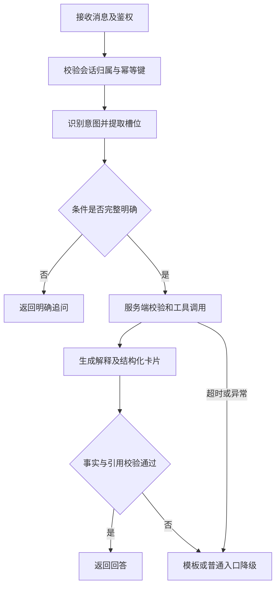

# 智慧社区停车位共享与结算系统特色功能详细设计说明书

版本：V1.1；日期：2026-10-16；依据：[项目计划](./项目计划.md)、[需求规格说明书](./需求规格说明书.md)。本次统一可选预算、规则版本范围、reservationId、账单输出结构及会话并发恢复。

## 1. 特色功能与技术边界

| 需求 | 用户价值 | 实现方法 |
|---|---|---|
| AI01 自然语言找车位 | 用日常语言表达社区、时间、预算 | 模型提取条件，服务端校验，工具查询实时业务 |
| AI02 规则问答 | 了解取消、计费、退款与结算规则 | 先检索有版本的条款，再生成有来源的回答 |
| AI03 本人账单解释 | 理解预付、超时补缴及退款 | 授权账单工具提供事实，模型解释，金额校验 |
| AI04 多轮条件修改 | 不必重复输入已确认条件 | 当前任务槽位保存，明确覆盖和追问 |
| AI05 降级与追踪 | 模型不可用时继续普通操作 | 限流、超时、模板和普通入口、脱敏日志 |

只使用现成模型 API，不训练模型。三个工具均只读，AI 不具备预约提交、付款、退款、结算权限。第一版关键词检索即可；向量检索属于后续验证选项。特色效果由实验验证，不能把接入模型本身表述为算法创新。

## 2. 模块与执行流程

模块分为 ConversationController、IntentRouter、SlotValidator、ToolRegistry、KnowledgeRetriever、AnswerVerifier、ModelAdapter 和 AiTraceRecorder。ModelAdapter 隔离供应商协议，其余模块使用统一消息及工具结构。



采用普通 HTTP 单轮响应；首版不要求 SSE。客户端可显示阶段提示，但最终回答、卡片与来源一起返回，避免未校验内容先展示。每次请求20秒总预算包含排队、模型、工具与最终生成，每轮最多2次工具，重试不重置截止。

## 3. 对话接口

`POST /api/v1/ai/sessions` 创建本人会话；`POST /api/v1/ai/sessions/{id}/messages` 提交消息，携带 `Idempotency-Key`；`GET /api/v1/ai/sessions/{id}/messages` 分页读取本人记录。会话和请求标识均不能代替身份校验。

请求示例：

```json
{
  "text": "明天上午九点到十一点，阳光社区，每小时不超过五元",
  "expectedSessionVersion": 0,
  "context": {"reservationId": null}
}
```

响应业务数据示例（示例日期仅用于固定测试时钟场景）：

```json
{
  "sessionId": "9001",
  "requestId": "req-9001-1",
  "sessionVersion": 1,
  "intent": "SEARCH_SPACE",
  "status": "ANSWERED",
  "answer": "找到符合条件的车位，请核对日期和时间后预约。",
  "slots": {
    "communityId": "101",
    "startAt": "2026-10-17T09:00:00+08:00",
    "endAt": "2026-10-17T11:00:00+08:00",
    "maxHourlyPriceFen": 500
  },
  "cards": [{"spaceId":"201","windowId":"301","quoteFen":800}],
  "citations": [],
  "fallbackReason": null
}
```

状态为 ANSWERED、CLARIFY、FALLBACK、REFUSED。卡片数据必须由工具结果映射，不从回答文本反向解析。认证失败返回401/403，不包装成成功回答。ID以字符串传输，金额为整数分。

成功响应统一包含requestId和sessionVersion；同键仍在处理中时HTTP202返回requestId、status=PROCESSING和当前sessionVersion，不伪造最终answer。处理进程崩溃并由租约恢复终结时返回status=FAILED及普通入口；PROCESSING/FAILED是请求生命周期状态，与四种最终回答分类区分。客户端可用消息历史查询原requestId结果。

## 4. 槽位与多轮处理

| 槽位 | 校验和缺失处理 |
|---|---|
| communityId | 社区名称经业务接口匹配；重名返回选项，不由模型生成ID |
| startAt、endAt | 服务端时钟解析相对日期，显示明确日期；含糊的“九点”未指定上下午且上下文不明确时追问 |
| maxHourlyPriceFen | 可选非负整数；省略或null表示不限价格，不因预算缺失追问；“便宜一点”要求明确上限，不任意减价；“不限价格”清除旧上限 |
| spaceType | 仅接受系统枚举，不认识的类型追问 |
| vehicleId | 普通确认页选择本人启用车辆；若上下文带车辆ID，由后端验证归属 |

每次修改只覆盖明确提到的字段；修改日期重新验证开始结束顺序、提前15分钟和30天上限。有效槽位由服务端保存，原始对话不是最终业务事实。单任务最多5轮，超过上限引导普通筛选。用户切换主题或点击新任务时重置槽位；账单订单上下文只对本次账单任务有效。

### 4.1 会话串行与崩溃恢复

同一会话同时最多一个处理中请求，不同会话可并发。消息请求必须包含expectedSessionVersion，新增会话初始版本0。先检查Idempotency-Key：同键同参已完成返回原结果，处理中返回202和requestId；同键异参返回409。新键请求在短事务内检查会话READY、版本相等、归属正确，设置PROCESSING、active_request_id、processing_token及25秒租约，登记消息后提交，不持锁调用模型。

会话繁忙的新请求返回409 SESSION_BUSY，版本过旧返回409 SESSION_VERSION_CONFLICT，不消耗新轮次。最终写回用processing_token和原版本作条件更新，原子保存槽位、回复、轮次、幂等结果，版本加1并释放会话。超时降级也以同样方式结束请求；每个被受理的用户轮次只计一次，重复请求不计轮次。

进程崩溃后每秒扫描过期租约，原子标记请求FAILED、释放会话、版本加1，保持原槽位；同键查询返回已结束失败结果，新意图需新键。旧执行者迟到结果因token失效无法覆盖新会话。20秒回答截止与25秒崩溃租约分别用于用户响应和接管，租约不是延长回答时间的理由。GET消息历史返回sessionVersion及activeRequest摘要，前端同步后再提交。

## 5. 工具契约

| 工具 | 入参 | 返回字段与约束 |
|---|---|---|
| searchAvailableSpaces | communityId、startAt、endAt、可选maxHourlyPriceFen和spaceType | 最多10个候选：spaceId、windowId、位置描述、hourlyPriceFen、quoteFen、queriedAt；业务侧过滤，不包含业主私人联系方式 |
| retrieveParkingRules | query、topic、可选communityId、可选ruleVersion | 最多5条已发布有效规则：ruleId、version、title、clause、effectiveAt、scope；历史订单版本由服务端注入 |
| getMyOrderBill | reservationId | billVersion、billAsOf、金额、时长、收退款、状态和快照规则；用户身份只取会话，不能传userId |

工具登记表固定名称、JSON Schema、权限和执行器。拒绝未知工具、额外字段、任意SQL和URL。内部业务接口仍执行归属校验，不能因请求来自AI而免检。跨用户订单返回统一无权访问结果，不泄露是否存在。

## 6. 知识条目与检索

条目包含 ruleId、version、title、topic、content、communityId、effectiveAt、expiresAt、status。全局条目用communityId=0，社区条目只补充适用须知；不能用社区文本覆盖平台计费公式。发布后正文不可覆盖修改，新版本需独立记录。

第一版先按主题和社区过滤，再按人工维护关键词及标题、正文匹配评分，返回最多5条。同ruleId、同communityId的版本有效期不得重叠；不同ruleId可属于同一主题且同时生效。有效期采用[effectiveAt,expiresAt)，结束为空表示无限。发布前先锁knowledge_rule中稳定存在的规则主记录，再检查版本和范围；首次建规则依靠唯一键创建或获取主记录，不能只锁尚不存在的版本行。无匹配返回无依据，不调用模型补造政策。历史账单优先使用冻结规则内容，旧知识版本停用不影响已冻结依据。

提示词分为固定职责、结构化上下文、可引用条款和用户问题四部分。用户输入及条款只作为数据，不可改变权限。输出引用必须来自本次检索ID集合，正文版本与引用一致；引用不存在则回退。

## 7. 账单解释与事实核验

标准账单对象提供预约开始结束、实际入离场、单价、预付、补缴、累计成功收款、累计成功退款、净支付及业务状态。金额卡片由前端直接渲染对象。解释采用“预约费用—超时费用—退款—当前净支付”顺序。

模型返回结构化事实引用和解释分段，不允许自由生成未经引用的新金额。后端校验引用字段、数值、单位和规则版本；出现未支持金额或状态断言时不展示原回答，使用后端模板。仅金额相等不能证明解释正确，验收还需检查时间、状态和引用逻辑。

### 7.1 可实现的账单输出契约

模型只选择解释原因、事实引用和条款，不自行填金额或时间；最终文本由后端按受控句式注入事实。模型原始输出示例：

```json
{
  "reservationId": "5001",
  "billVersion": 7,
  "segments": [
    {"reasonCode":"PREPAY_BY_RESERVED_DURATION","factRefs":["prepayFen","reservedMinutes","hourlyPriceFen"]},
    {"reasonCode":"OVERTIME_ROUNDED_UP","factRefs":["overtimeSeconds","overtimeFen"]},
    {"reasonCode":"REFUND_SUCCEEDED","factRefs":["refundedFen","netPaidFen"]}
  ],
  "citations": [{"ruleId":"PARKING_BILLING","version":1,"communityId":"0"}]
}
```

| 字段／规则 | 校验要求 |
|---|---|
| reservationId、billVersion | 必须与本次授权账单完全相同；不能接受模型更换订单 |
| reasonCode | 仅允许预付、超时、退款成功、退款处理中、净支付汇总五类枚举；每类配置必要字段及状态前提 |
| factRefs | 只能引用本次账单允许字段；不得传入任意表达式、路径或自定义金额 |
| citations | 必须来自本次提供的条款集合或冻结快照，编号、版本、适用范围全部匹配 |
| 状态与数值 | 超时为0不能解释为发生超时费；退款未成功不能选择退款成功原因；缺失事实不能推测 |

剩余两种reasonCode为REFUND_PENDING、NET_PAYMENT_SUMMARY。字段白名单包含prepayFen、reservedMinutes、hourlyPriceFen、overtimeSeconds、overtimeFen、paidFen、refundedFen、pendingRefundFen、netPaidFen及必要状态；所有数值从后端取，不接收模型回填值。拒绝未知字段及未审查自由文本，正常路径不展示模型原始输出。

正常完成指模型选择正确原因、字段和依据，后端受控渲染通过；不把受控渲染本身计作降级。模型缺席、输出错误或超时后采用默认账单摘要才计FALLBACK，且不能算AI完成。验收同时判定原因和引用，不能仅因页面金额正确就通过。

返回前由服务器额外执行一次只读billVersion核验，计入20秒总时限，不占模型最多2次工具名额；如果账单变化，读取新账单并以新版本默认摘要降级，不继续展示旧解释。最终响应包含billVersion、billAsOf和projectionUpdatedAt，说明为该版本快照，不承诺展示后绝不变化。billVersion在任何影响账单的资金或履约事实更新时递增。

固定案例：4元/小时，09:00—11:00预约8元，11:20离场补缴2元；实收10元，退款2元后净支付8元。若退款仍未知，应说“退款处理中，当前成功退款为0”，不得提前显示净支付8元。

## 8. 资源、日志与数据保护

初始并发10、队列10、最多等待1秒；独立执行器和HTTP连接池。AI执行期间不持有数据库事务。模型调用超时、限流和预算耗尽返回普通入口；不静默切换到未经登记的模型。

日志保存traceId、意图、工具名、耗时、模型及提示词版本、token用量、结果分类，正文按需脱敏。不得把令牌、完整手机号、完整车牌、密码或支付密钥放入模型上下文。会话默认保留30天，清理不影响资金和审计记录。个人账单答案不共享缓存，规则缓存包含范围和版本，车位卡片只代表查询时刻。

## 9. 验收、实验与交付

固定100条验收样例：查询30、规则30、账单20、边界20，另建开发集。前80条按场景验收正确完成率≥90%、降级率≤10%；边界20条全部符合预期。模板回退保障安全但不计AI完成。3轮独立评测分别达标。另设确定性AT07会话并发、AT08预算与结构契约检查，不混入100条模型能力样例的比例。负载及EX01—EX03见[测试与部署设计说明书](./测试与部署设计说明书.md)。

交付包括适配器、工具Schema、版本化提示词、知识条目、脱敏样例、原始结果、成本统计及普通操作降级入口。模型名称、预算和依赖版本由预研锁定；本文不宣称任何未实测效果。
